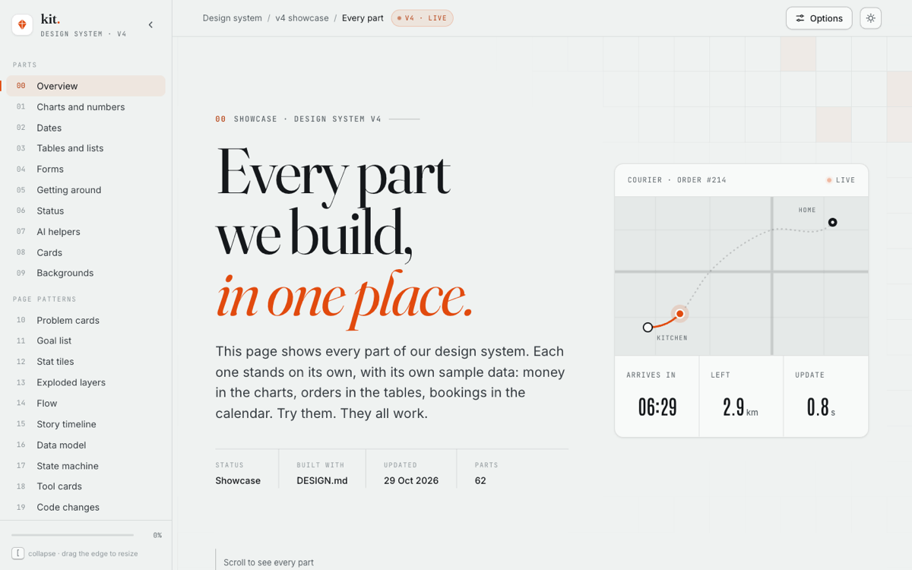

# ember-kit

A design system for Claude Code. Install it once, and every page, diagram
or figure Claude builds for you comes out in the same calm look: warm paper,
ink, one burnt-orange accent, five fonts, slow motion and plain words.

<picture>
  <source media="(prefers-color-scheme: dark)" srcset="assets/showcase-night.png">
  
</picture>

## What you get

- **A look Claude follows on its own.** `DESIGN.md` sets the colours, type,
  motion and words. Claude reads it before any design work, in any project.
- **85 working parts.** Charts, dates, tables, forms, steppers, toasts,
  cards, backgrounds and more, each in plain HTML, CSS and JavaScript, with
  no build step. All of them are on one page:
  `components/showcase/index.html`.
- **17 pattern files.** Exploded layers, story timelines, state machines,
  data models and more. Each one says what it is, why it works, how it is
  built, and gives a prompt to rebuild it.
- **A taste guide for Claude.** `patterns/taste.md` says which version of
  each part to build, and why. It comes from 25 parts tried side by side
  in 122 versions, so Claude builds the lively version you would pick
  without asking.
- **Diagram rules.** Which tool draws what (Archify, Diagram Design or
  Hairline), the dot-grid canvas, and the checks to run.
- **A checklist** Claude runs before it calls a page done: contrast, motion,
  the 390 px phone width, and more.
- **A light and a night theme**, and three motion levels: off, calm and
  lively.

## The look in one minute

| | |
|---|---|
| Paper | `#eff2f1`, warm, never white |
| Ink | `#15181b` |
| Accent | burnt orange `#e14a0e` (big things), `#b33a0a` (small text) |
| Fonts | Fraunces (headings), Space Grotesk (display), Inter (body), JetBrains Mono (labels, code), Antonio (numbers) |
| State | Progress, done and errors are orange and ink. No green, red or blue |
| Motion | Controls answer fast; content enters slowly, once |
| Words | Plain 6th-grade English. Every heading is a claim |

The full rules are in `DESIGN.md`.

## Quick start

1. Clone it to the place every file expects:

   ```bash
   git clone https://github.com/waruingugi/ember-kit ~/.claude/design
   ```

2. Turn it on. This rule tells Claude Code to read `DESIGN.md` first:

   ```bash
   mkdir -p ~/.claude/rules
   cp ~/.claude/design/claude/rules/design.md ~/.claude/rules/design.md
   ```

3. See it. Open the showcase in a browser:

   ```bash
   open ~/.claude/design/components/showcase/index.html     # macOS
   xdg-open ~/.claude/design/components/showcase/index.html # Linux
   ```

That is enough for the look. For the full toolkit (diagram tools, motion
skills and page scanners, each pinned to a tested version), follow
`tools/setup.md`.

## Using it

Ask Claude Code for a page the way you normally would:

> Build a one-page overview of our payment flow for new engineers.

Claude reads `DESIGN.md`, picks the patterns the page needs, builds from
`components/`, and runs the checklist. It stops and asks you first when:

- your project already has its own theme that differs from this one;
- code it copies from somewhere else uses another look;
- a change would alter the look (a new colour, font, layout or motion).

**It learns.** When you give feedback on how things look or move ("the
cards come in too softly"), Claude writes it into the right file here, in
plain words, and adds a dated line to `CHANGELOG.md`. Commit and push the
folder now and then, so your rules travel with you.

**It learns your taste.** When a part matters, Claude builds three or four
versions side by side, the lively one first, and you keep the ones you
like (`patterns/compare-parts.md`). Each pick goes into `notes/choices.md`
and becomes a rule in `patterns/taste.md`.

## How it is built

```
~/.claude/rules/design.md   →   DESIGN.md   →   one pattern or tool file
   (always loaded)              (the core)       (only when the picker says so)
```

`DESIGN.md` is kept short on purpose. Its picker table sends Claude to the
one file a page needs, so Claude does not read the whole folder every time.

| Folder | What is in it |
|---|---|
| `DESIGN.md` | The core: ask-first rules, the picker, colours, type, parts, motion, words and the checklist |
| `components/` | `tokens.css` and `components.css`, the small parts, `showcase/` (all 85 parts on one page, the master copy) and `parts/` (each part as its own file, made from the showcase) |
| `patterns/` | One file per page pattern |
| `tools/` | How to use each tool: diagrams, Hairline, Anatomy, GSAP, Motion, publishing, setup. `taste-lab/` holds every version the owner tried, side by side, and how to run a new round. Also two small builders: `diagram_svg.py` (hand-drawn diagrams) and `build_layers.py` (an exploded layer stack) |
| `hairline/` | A small library of Hairline figures, with a log |
| `notes/` | The owner's taste, in full |
| `claude/` | Files to copy into `~/.claude`: the rule, the `ember` Diagram Design profile, and six skills, `craft` (make a page well and prove it), `motion-ecosystem` (pick and wire motion libraries), `hairline-create` (Lucas Marques's Hairline figure skill, MIT, pinned `37d2e78`) `beui` (find free beUI parts to reuse, MIT, pinned `a866cb2`) `shadcn` (shadcn/ui's own skill, MIT, pinned `4233ed1`) and `hallmark` (nutlope's anti-slop linter, MIT, pinned `4f6a46c`, used as a checker only) |
| `vendor/` | Hairline 0.5.1 (MIT, licence included) |
| `scripts/` | `show-reference.sh` opens any page in Chrome; `check-updates.sh` says whether a pinned tool has a newer version (it only reports); `split.mjs`, `assemble.mjs`, `singles.mjs`, `match.mjs` and `diff.mjs` cut the showcase into parts, build pages from them and check they still look the same (see `components/parts/README.md`); `lint-paths.mjs` checks every path the docs name |
| `assets/` | The screenshots in this file |
| `CHANGELOG.md` | Every change, newest first |

## Make it yours

The files call the person they serve "the owner". Once you install it,
that is you, so there is no name to change.

To change the look, edit `components/tokens.css` and the matching tables in
`DESIGN.md` together, then add a line to `CHANGELOG.md`. Or just tell
Claude what you want changed; it will ask first, then update both.

## Needs

- Claude Code.
- A modern browser to view the parts. They are single HTML files with no
  build step; GSAP and fonts load from public CDNs.
- For the full toolkit only: Node 18+, Python 3.10+ and git
  (`tools/setup.md`).

## Credits

Built on other people's work, each used at a pinned version:
[Hairline](https://github.com/lucasmarkes/hairline) (Lucas Marques),
[Diagram Design](https://github.com/cathrynlavery/diagram-design) (Cathryn
Lavery; the `ember` profile is a changed copy of its style guide),
[Archify](https://github.com/tt-a1i/archify),
[Anatomy](https://github.com/wheresryan22/anatomy),
[shadcn/ui](https://ui.shadcn.com),
[Hallmark](https://github.com/nutlope/hallmark),
[beUI](https://beui.dev) (Saurabh Chauhan; free parts only),
[GSAP](https://gsap.com) and its [skills](https://github.com/greensock/gsap-skills),
[Motion](https://motion.dev),
[Emil Kowalski's skills](https://github.com/emilkowalski/skills),
[design-motion-principles](https://github.com/kylezantos/design-motion-principles)
(Kyle Zantos), and [easyui.site](https://easyui.site) (the ideas behind many
newer parts, rebuilt here in plain HTML, CSS and JavaScript).

## Licence

MIT, see `LICENSE`. The copied third-party parts keep their own MIT
licences: Hairline (`vendor/`) and the `ember` profile, which is based on
Diagram Design (credit inside the file).
