# Table

Made from house part `n37` ("Sort, and rows glide to their place.") by `node kit/build.mjs table` on 2026-11-24. Every code block, number and picture below comes from the live part. Don't edit `table.md`; edit `table.src.md` or the showcase, then rebuild.

**Use it for** rows people scan, sort, search, tick and act on: orders, invoices, drivers, vehicles.
**Don't use it for** three rows or fewer (use a list), or rows that open into detail (that's `c15`, for quiet pages only).

## The fastest exact start

Open `table/table.starter.html`. It's a whole working page with this table. Copy it, then change only the words, the data and the columns. Keep every class, rule and script as it is.

## Pictures

Look at these before you build. Your table must look like this in every state, in both themes.

| State | Light | Night |
|---|---|---|
| rest | 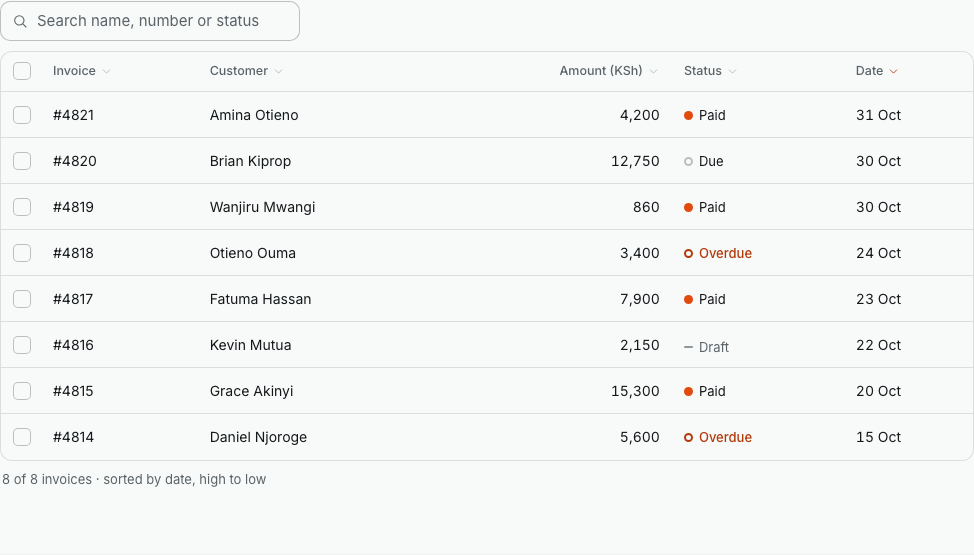 | 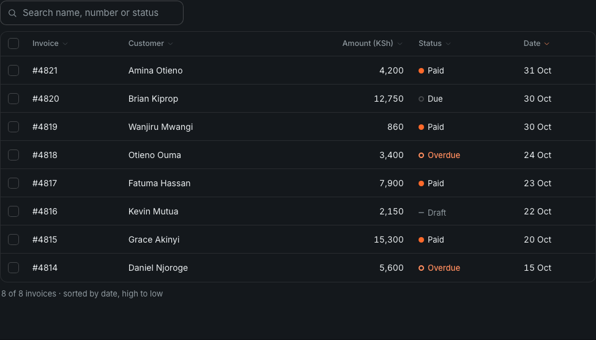 |
| hover | 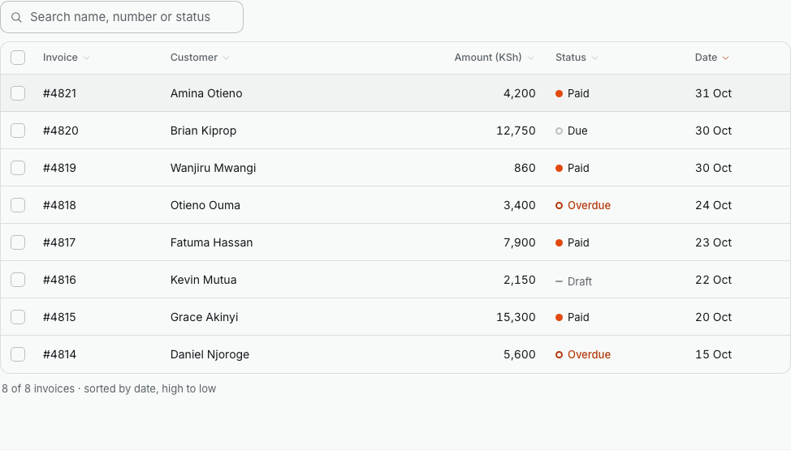 | 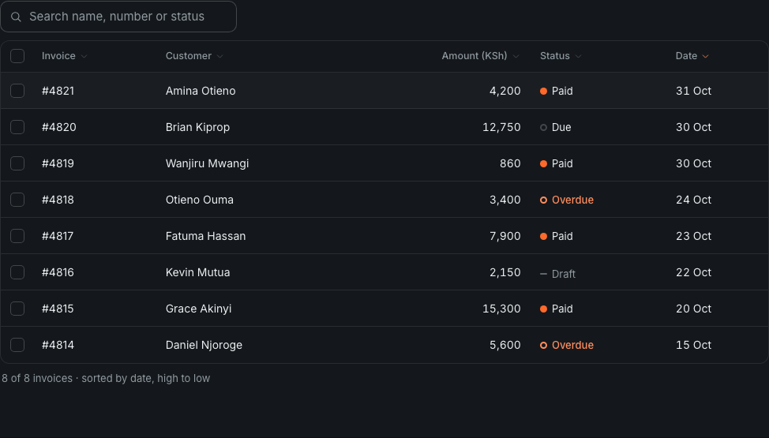 |
| sorted | 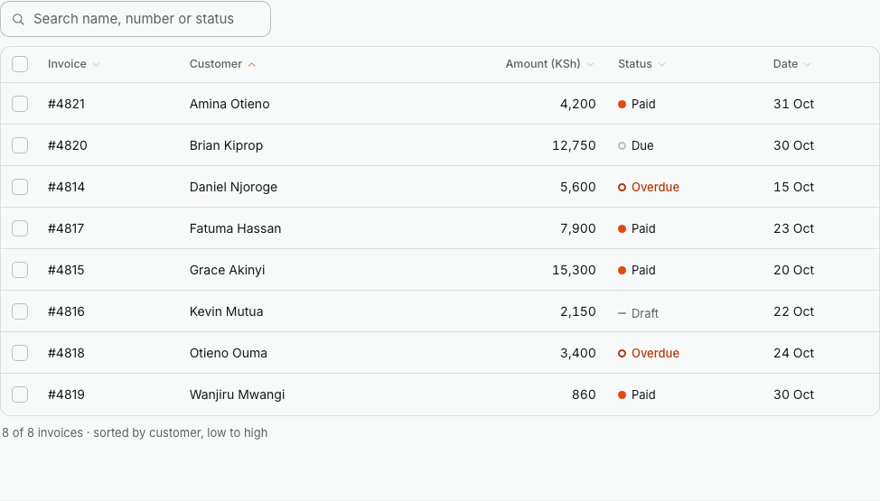 | 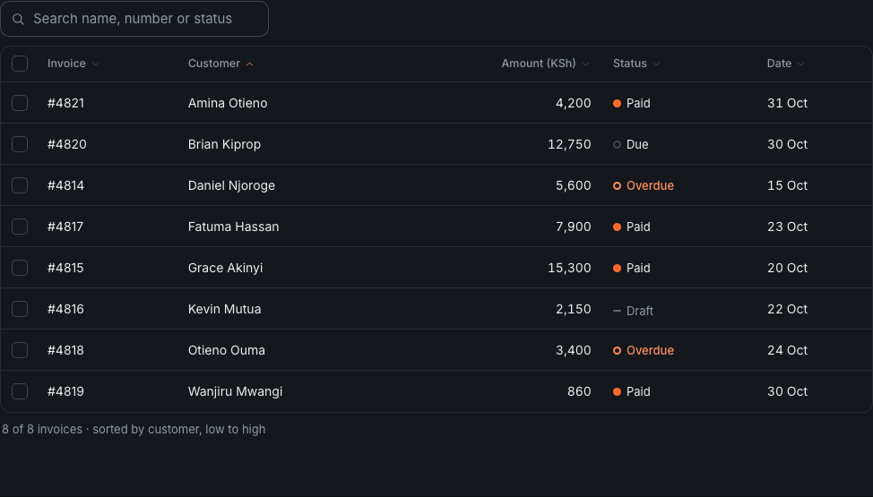 |
| picked | 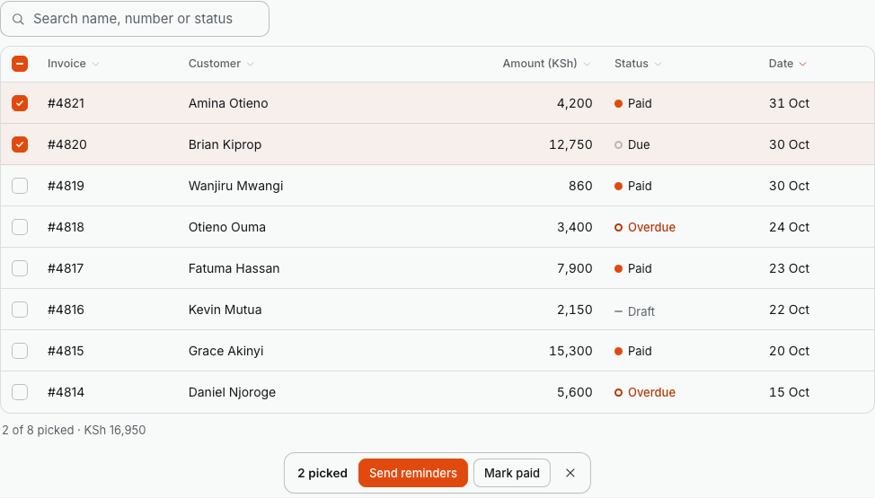 | 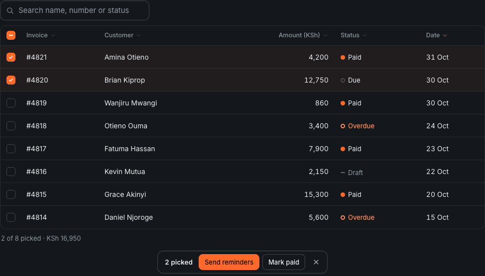 |
| empty | 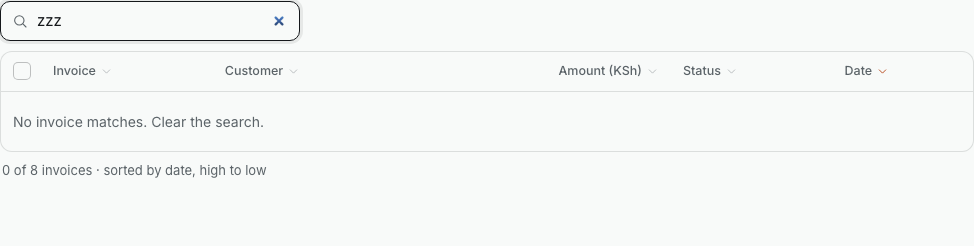 | 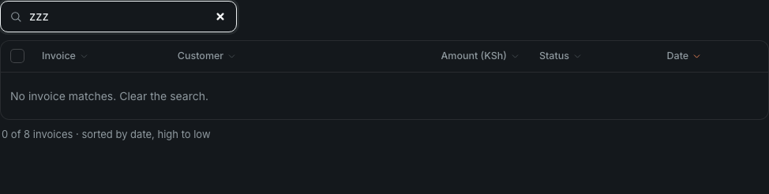 |

Phone (390 px): 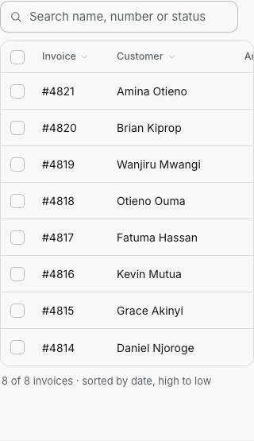

## Sizes and colours

Measured in the browser at rest (1440 px wide, light). Colours are named by token: use the token, never the hex.

| Element | Size (px) | Padding | Font | Text | Fill | Border | Corners |
|---|---|---|---|---|---|---|---|
| search field | 300 × 40 | 0 12 0 36 | Inter 15px / 400 | var(--canvas) | var(--paper-raised) | 1px var(--line-hi) | 10px |
| table card | 974 × 410 | 0 0 0 0 | Inter 17px / 400 | var(--canvas) | var(--paper-raised) | 1px var(--line) | 12px |
| header cell | 242 × 40 | 0 12 0 12 | Inter 12.5px / 500 | var(--muted) | none | 1px var(--line) | 0px |
| sort button | 87 × 30 | 0 6 0 6 | Inter 12.5px / 500 | var(--muted) | none | none | 6px |
| checkbox | 18 × 18 | 0 0 0 0 | Inter 14px / 400 | var(--canvas) | var(--paper-raised) | 1px var(--line-hi) | 5px |
| row | 972 × 46 | 0 0 0 0 | Inter 14px / 400 | var(--canvas) | none | none | 0px |
| cell | 242 × 46 | 0 12 0 12 | Inter 14px / 400 | var(--canvas) | none | 1px var(--line) | 0px |
| number cell | 232 × 46 | 0 12 0 12 | Inter 14px / 400 | var(--canvas) | none | 1px var(--line) | 0px |
| status | 42 × 21 | 0 0 0 0 | Inter 13px / 400 | var(--canvas) | none | none | 0px |
| foot line | 970 × 21 | 0 0 0 0 | Inter 13px / 400 | var(--muted) | none | none | 0px |
| selection bar | 342 × 46 | 6 6 6 14 | Inter 13.5px / 400 | var(--canvas) | var(--paper-raised) | 1px var(--line-hi) | 12px |
| bar count | 56 × 22 | 0 0 0 0 | Inter 13.5px / 600 | var(--canvas) | none | none | 0px |
| bar main button | 122 × 32 | 0 11 0 11 | Inter 13px / 500 | rgb(255, 255, 255) | var(--accent) | 1px var(--accent) | 8px |
| bar button | 86 × 32 | 0 11 0 11 | Inter 13px / 500 | var(--canvas) | var(--paper-raised) | 1px var(--line-hi) | 8px |
| bar clear | 32 × 32 | 0 0 0 0 | Inter 13px / 500 | var(--ink-soft) | none | 1px none | 8px |
| problem status | 68 × 21 | 0 0 0 0 | Inter 13px / 500 | var(--accent-text) | none | none | 0px |
| neutral status | 45 × 21 | 0 0 0 0 | Inter 13px / 400 | var(--muted) | none | none | 0px |

## States

How each state differs from rest, measured:

- **hover** (point at a row): row bg: none → **rgba(21, 24, 27, 0.03)**
- **sort-hover** (point at a header): sort button color: var(--muted) → **var(--canvas)**; sort button bg: none → **var(--paper-sunk)**
- **sorted** (press a header once: low to high, arrow turns orange and flips): no change in the measured elements
- **picked** (tick two rows: rows tint, the bar rises): checkbox bg: var(--paper-raised) → **var(--accent)**; checkbox border: 1px var(--line-hi) → **1px var(--accent)**; row bg: none → **rgba(225, 74, 14, 0.06)**
- **empty** (search for something that isn't there): search field border: 1px var(--line-hi) → **1px var(--canvas)**; search field shadow: none → **yes**

## Motion

Recorded while the part was used, with motion on. Copy the code below and you get all of it; don't rebuild it with other values.

| When | What moves | Property | Time | Curve | Kind |
|---|---|---|---|---|---|
| Point at a row | tr | background-color | 120 ms | `var(--ease-out)` | transition |
| Point at a header | nothing | | | | |
| Sort a column | svg.i | transform | 200 ms | `var(--ease-out)` | transition |
| Sort a column | tr (×8) | transform from "translateY(92px)" | 420 ms | `var(--ease-out)` | script |
| Tick a row | div.tbl-bar | opacity | 200 ms | `var(--ease-out)` | transition |
| Tick a row | div.tbl-bar | transform | 370 ms | `var(--sp-snappy)` | transition |
| Clear the ticks | div.tbl-bar | transform | 370 ms | `var(--sp-snappy)` | transition |
| Clear the ticks | div.tbl-bar | opacity | 200 ms | `var(--ease-out)` | transition |
| Clear the ticks | div.tbl-bar | transform | 250 ms | `var(--ease-out)` | transition |
| Clear the ticks | div.tbl-bar | visibility | 0 ms after 250 ms | `linear` | transition |
| Type in search | input.in | border-bottom-color | 150 ms | `var(--ease-out)` | transition |
| Type in search | input.in | border-left-color | 150 ms | `var(--ease-out)` | transition |
| Type in search | input.in | border-right-color | 150 ms | `var(--ease-out)` | transition |
| Type in search | input.in | border-top-color | 150 ms | `var(--ease-out)` | transition |
| Type in search | tr | transform from "translateY(-120px)" | 420 ms | `var(--ease-out)` | script |

- With reduced motion (the motion level `off`), rows jump to their place and nothing glides. The script checks this itself (`lv()`).
- The bar rises on the house snappy spring (`--sp-snappy`, `--sp-snappy-d`). Both come from `table/table.css`. Motion is always lively; it is off only when the reader's system asks for less motion.
- Only `transform`, `opacity` and colours move. Nothing animates size.

## Markup

The one allowed markup. Change the words, the columns (one `<th data-k="N">` per column, numbered from 0) and the bar's actions. Keep every class and `aria-` attribute.

```html
<div class="tbl">
      <div class="tbl-top">
<div class="tbl-search"><svg class="i" aria-hidden="true"><use href="#i-search"></use></svg>
<input class="in" type="search" placeholder="Search name, number or status" aria-label="Search invoices">
</div>
</div>
      <div class="tbl-scroll">
<table>
<thead>
<tr>
<th class="tbl-ckc">
<button class="tbl-cb" type="button" role="checkbox" aria-checked="false" aria-label="Pick all invoices"><svg viewBox="0 0 16 16" aria-hidden="true"><path d="M3.8 8.3 6.7 11 12.2 5"></path></svg></button></th>
<th data-k="0" aria-sort="none">
<button class="tbl-sort" type="button">Invoice<svg class="i s" aria-hidden="true"><use href="#i-cd"></use></svg></button></th>
<th data-k="1" aria-sort="none">
<button class="tbl-sort" type="button">Customer<svg class="i s" aria-hidden="true"><use href="#i-cd"></use></svg></button></th>
<th data-k="2" aria-sort="none" class="tbl-end">
<button class="tbl-sort" type="button">Amount (KSh)<svg class="i s" aria-hidden="true"><use href="#i-cd"></use></svg></button></th>
<th data-k="3" aria-sort="none">
<button class="tbl-sort" type="button">Status<svg class="i s" aria-hidden="true"><use href="#i-cd"></use></svg></button></th>
<th data-k="4" aria-sort="descending">
<button class="tbl-sort" type="button">Date<svg class="i s" aria-hidden="true"><use href="#i-cd"></use></svg></button></th></tr></thead>
<tbody></tbody>
</table>
</div>
      <p class="tbl-foot" aria-live="polite">
</p>
      <div class="tbl-bar" aria-hidden="true">
<span class="tbl-count"></span>
<button class="b sm pri" type="button" tabindex="-1" data-bx="Reminders sent by SMS.">Send reminders</button>
<button class="b sm" type="button" tabindex="-1" data-bx="Marked as paid.">Mark paid</button>
<button class="b sm q tbl-x" type="button" tabindex="-1" aria-label="Clear picks" data-bc=""><svg class="i" aria-hidden="true"><use href="#i-x"></use></svg></button>
</div>
    </div>
```

Icons it uses, once per page (put this as the first thing in `<body>`):

```html
<svg width="0" height="0" style="position:absolute" aria-hidden="true">
  <symbol id="i-search" viewBox="0 0 24 24"><circle cx="11" cy="11" r="7"/><path d="m21 21-4.3-4.3"/></symbol>
  <symbol id="i-cd" viewBox="0 0 24 24"><path d="m6 9 6 6 6-6"/></symbol>
  <symbol id="i-x" viewBox="0 0 24 24"><path d="M18 6 6 18M6 6l12 12"/></symbol>
</svg>
```

Rules for the markup:
- The page (or a box around the table) has the class `kit`. The CSS depends on it.
- **Put the status column second**, right after the name, so it still shows at 390 px. The table scrolls sideways inside its own box on a phone; what people scan for must be in the first columns.
- A column of numbers or money gets `tbl-end tbl-num` on both its `<th>` and its cells, so it lines up on the right.
- Status words use `<span class="tbl-st" data-s="done|due|late|idle">`: done is a filled accent dot, due (waiting) a grey ring, late (a problem) an accent ring with accent words, idle (neutral: draft, off, paused) a short grey dash with muted words. There is no green or red. Map every state you have to one of these four.
- A plate or code column: wrap the value in `<code>` and add one rule, `.kit .tbl code { font: 500 13px var(--font-mono); background: none; padding: 0; border: 0; }` (it must start with `.kit`, or the page's own code style wins).
- **The toolbar.** Every list people add to has an Add button on the search's row, at the right end:
  ```html
  <div class="tbl-top" style="display:flex;justify-content:space-between;align-items:center;gap:12px">
    <label class="tbl-search">…the search, as above…</label>
    <button class="b pri" type="button">Add invoice</button>
  </div>
  ```
  Tabs over the table are its states (All, Paid, Due, Late) and sit above the toolbar: use part `n71`, and call the table's `setRows` with the rows for the picked tab. Kinds of thing go in a Filters menu.
- Each bar button has `data-bx="what happened"`. The foot line shows those words after the action. The × has `data-bc`.
- The bar's buttons start with `tabindex="-1"`. The script puts them back in the tab order when the bar shows.

## CSS

Paste all of `table/table.css` into the page's `<style>`. It is 75 rules: the tokens for both themes, the page base, the button, the field, the icon, and the table. Don't retype it, trim it or rename its classes.

## Behaviour

Paste this once per page. It is the same script the showcase runs.

```js
/* tbl:begin. The table piece's behaviour (kit/cards/table.md). One copy, shared by every table. */
function emberTable(box, cfg) {
  "use strict";
  var root = document.documentElement;
  function lv() { var m = root.dataset.motion || "lively"; if (matchMedia("(prefers-reduced-motion: reduce)").matches) m = "off"; return m; }
  function $(s, el) { return (el || box).querySelector(s); }
  function $$(s, el) { return [].slice.call((el || box).querySelectorAll(s)); }
  var ROWS = cfg.rows, cols = cfg.columns, idOf = cfg.id;
  var tb = $("tbody"), foot = $(".tbl-foot"), all = $("thead .tbl-cb"), bar = $(".tbl-bar"), bn = $(".tbl-count"), search = $(".tbl-search input");
  var sort = { k: cfg.sort.k, dir: cfg.sort.dir }, sel = {}, q = "";
  var CB = '<svg viewBox="0 0 16 16" aria-hidden="true"><path d="M3.8 8.3 6.7 11 12.2 5"/></svg>';
  function rows() { return ROWS.filter(function (x) { return !q || cfg.text(x).toLowerCase().indexOf(q) >= 0; }).sort(function (a, b) { var A = cols[sort.k].get(a), B = cols[sort.k].get(b); return (A > B ? 1 : A < B ? -1 : 0) * sort.dir; }); }
  function cell(c, r) { return "<td" + (c.cls ? ' class="' + c.cls + '"' : "") + ">" + c.html(r) + "</td>"; }
  function render() {
    var flip = lv() !== "off", before = {};
    if (flip) $$("tr[data-id]", tb).forEach(function (tr) { before[tr.dataset.id] = tr.getBoundingClientRect().top; });
    var rs = rows();
    tb.innerHTML = rs.map(function (r) { var id = idOf(r), s = !!sel[id]; return '<tr data-id="' + id + '" aria-selected="' + s + '"><td class="tbl-ckc"><button class="tbl-cb" type="button" role="checkbox" aria-checked="' + s + '" aria-label="' + cfg.pickLabel(r) + '">' + CB + "</button></td>" + cols.map(function (c) { return cell(c, r); }).join("") + "</tr>"; }).join("") || '<tr class="tbl-empty"><td colspan="' + (cols.length + 1) + '">' + cfg.empty + "</td></tr>";
    $$("tr[data-id]", tb).forEach(function (tr) {
      $(".tbl-cb", tr).addEventListener("click", function () { sel[tr.dataset.id] = !sel[tr.dataset.id]; render(); var b = $('tr[data-id="' + tr.dataset.id + '"] .tbl-cb', tb); if (b) b.focus(); });
      var b0 = before[tr.dataset.id]; if (flip && b0 !== undefined) { var d = b0 - tr.getBoundingClientRect().top; if (d) tr.animate([{ transform: "translateY(" + d + "px)" }, { transform: "none" }], { duration: 420, easing: "cubic-bezier(.22,1,.36,1)" }); }
    });
    var ids = Object.keys(sel).filter(function (k) { return sel[k]; }), picked = ROWS.filter(function (r) { return sel[idOf(r)]; }), on = ids.length > 0;
    all.setAttribute("aria-checked", ids.length === ROWS.length ? "true" : on ? "mixed" : "false");
    foot.textContent = on ? ids.length + " of " + ROWS.length + " picked" + (cfg.pickedNote ? cfg.pickedNote(picked) : "") : rs.length + " of " + ROWS.length + " " + cfg.noun + " · sorted by " + cols[sort.k].name + (sort.dir > 0 ? ", low to high" : ", high to low");
    bar.classList.toggle("is-on", on); bar.setAttribute("aria-hidden", String(!on)); $$("button", bar).forEach(function (b) { b.tabIndex = on ? 0 : -1; }); bn.textContent = ids.length + " picked";
  }
  function clear() { for (var k in sel) sel[k] = false; render(); }
  $$("th[data-k]").forEach(function (h) { $(".tbl-sort", h).addEventListener("click", function () { var k = +h.dataset.k; sort = { k: k, dir: sort.k === k ? -sort.dir : 1 }; $$("th[data-k]").forEach(function (x) { x.setAttribute("aria-sort", +x.dataset.k === k ? (sort.dir > 0 ? "ascending" : "descending") : "none"); }); render(); }); });
  all.addEventListener("click", function () { var on = all.getAttribute("aria-checked") !== "true"; ROWS.forEach(function (r) { sel[idOf(r)] = on; }); render(); });
  if (search) search.addEventListener("input", function (e) { q = e.target.value.trim().toLowerCase(); render(); });
  $$("[data-bx]", bar).forEach(function (b) { b.addEventListener("click", function () { var m = b.getAttribute("data-bx"), ids = Object.keys(sel).filter(function (k) { return sel[k]; }); clear(); foot.textContent = m; all.focus(); if (cfg.onAction) cfg.onAction(b, ids); }); });
  $("[data-bc]", bar).addEventListener("click", function () { clear(); all.focus(); });
  render();
  /* a handle for pages that change the data (tabs, React state): rows glide to their new places; ticks on rows that left are dropped */
  return { setRows: function (next) { ROWS = next; var keep = {}; ROWS.forEach(function (r) { var id = idOf(r); if (sel[id]) keep[id] = true; }); sel = keep; render(); }, rows: function () { return ROWS.slice(); } };
}
/* Cell html is written into the page as is: pass any text that came from people through emberTable.esc. */
emberTable.esc = function (s) { return String(s).replace(/[&<>"']/g, function (c) { return { "&": "&amp;", "<": "&lt;", ">": "&gt;", '"': "&quot;", "'": "&#39;" }[c]; }); };
/* tbl:end */
```

Then start each table with its own data. This is the showcase's own call; yours changes only the data, columns and words:

```js
(function () {
  "use strict";
  var box = document.getElementById("n37"); if (!box) return;
  var ROWS = [["4821","Amina Otieno",4200,"Paid","2026-10-31"],["4820","Brian Kiprop",12750,"Due","2026-10-30"],["4819","Wanjiru Mwangi",860,"Paid","2026-10-30"],["4818","Otieno Ouma",3400,"Overdue","2026-10-24"],["4817","Fatuma Hassan",7900,"Paid","2026-10-23"],["4816","Kevin Mutua",2150,"Draft","2026-10-22"],["4815","Grace Akinyi",15300,"Paid","2026-10-20"],["4814","Daniel Njoroge",5600,"Overdue","2026-10-15"]];
  var STATE = { Paid: "done", Due: "due", Overdue: "late", Draft: "idle" }, M = ["Jan", "Feb", "Mar", "Apr", "May", "Jun", "Jul", "Aug", "Sep", "Oct", "Nov", "Dec"];
  function money(n) { return n.toLocaleString("en-KE"); }
  function day(d) { return +d.slice(8) + " " + M[+d.slice(5, 7) - 1]; }
  emberTable(box.querySelector(".tbl"), {
    rows: ROWS, id: function (r) { return r[0]; }, noun: "invoices", empty: "No invoice matches. Clear the search.",
    pickLabel: function (r) { return "Pick invoice " + r[0]; },
    text: function (r) { return r[0] + " " + r[1] + " " + r[3]; },
    sort: { k: 4, dir: -1 },
    columns: [
      { name: "number", get: function (r) { return r[0]; }, html: function (r) { return "#" + r[0]; } },
      { name: "customer", get: function (r) { return r[1]; }, html: function (r) { return r[1]; } },
      { name: "amount", get: function (r) { return r[2]; }, html: function (r) { return money(r[2]); }, cls: "tbl-end tbl-num" },
      { name: "status", get: function (r) { return r[3]; }, html: function (r) { return '<span class="tbl-st" data-s="' + STATE[r[3]] + '">' + r[3] + "</span>"; } },
      { name: "date", get: function (r) { return r[4]; }, html: function (r) { return day(r[4]); }, cls: "tbl-num" }
    ],
    pickedNote: function (picked) { return " · KSh " + money(picked.reduce(function (a, r) { return a + r[2]; }, 0)); }
  });
})();
```

- `columns[k]` matches `<th data-k="k">`. `get` is the value to sort by (a number for money, an ISO date for dates). `html` is what the cell shows.
- **Pass any text that came from people through `emberTable.esc()`** before it goes into `html`. Names, notes and search results can hold `<` and quotes.
- `onAction(button, ids)` runs after a bar action, with the ids that were ticked. Use it to call your server.
- `emberTable()` returns a handle: `setRows(rows)` swaps the data in place (rows glide; ticks on rows that left are dropped), and `rows()` gives the current data. Use it for tabs, after an action changes rows (Retire, Suspend, Undo), and in React.

## Rules for tables

From `DESIGN.md` and `patterns/taste.md`, the owner's own words:
- **This is the table for sorting, searching and acting on rows** (Taste Lab round 1: "B but with a search as well"). `c15` is for quiet pages only.
- **Tabs over a table are its states** (All, Active, Deactivated). **Kinds are filters** (kitchen, branch, depot) and go in a Filters menu. A list with no states and nothing to filter shows no tabs row and no Filters button.
- **Every table people add to has an Add button** at the right end of the toolbar, orange, naming the thing ("Add vehicle"). It opens the side sheet with an empty form. After saving, the table goes to the page with the new row, and that row glows once.
- **The action is the confirmation.** A bulk action runs at once and says so. Never ask "Are you sure?". Offer Undo where it can be undone.
- **A badge that marks a whole record** (a verified tick) shows once, in the record's own header, never on every row.
- **A number plate is a code**: mono font everywhere.
- **Search finds what people type**: a plate, a name, or a phone typed the local way (0711…) still matches.
- **A list by date** gets its own date button next to its search ("The button grows into a calendar", `n73`).
- **Every button that sends a request** shows three bouncing dots while it works and keeps its width.
- **Open question for the owner:** `DESIGN.md` (2026-11-15) says the selection bar should be at least 560 px wide and about 60 px tall, with 38 px buttons. Part `n37` still has the smaller bar measured above. Until the owner picks, build what this card measures; the check compares against `n37`.

## Laws

| Law | How the table meets it |
|---|---|
| Fitts | Rows are 46 px. The 18 px checkbox has a 42 px tap area (its `::before` reaches 12 px out). The bar sits at the bottom, next to the rows it acts on. |
| Hick | One orange button in the bar. At most three actions in the bar, then a "More" menu. |
| Jakob | Headers are buttons that sort. Press again to flip. The tick-all box sits at the top left. |
| Proximity | The search sits 10 px above the table card. The foot line sits 8 px under it. |
| Similarity | Every table on every page uses these classes. Nothing that isn't a button looks like one. |
| Von Restorff | Orange marks only the sorted arrow, paid dots, late words, ticks and the one main button. |
| Doherty | A tick changes the row at once. The bar rises within 0.4 s. |
| Postel | Search ignores case and spaces at the ends. |

## Don't

What copies have got wrong. Each item came from a real failed build.
- Header in mono capitals with letter spacing. The header is Inter 12.5 px, weight 500, `--muted`, normal case. (Claude, 2026-11-23)
- Padding guessed per cell, rows as tall as their text. Rows are 46 px, headers 40 px, sides 12 px. (Claude, 2026-11-23)
- No row hover, or no picked tint. Hover is ink at 3%, picked is orange at 6%. (Claude, 2026-11-23)
- Classes renamed with a prefix (`fl-b`, `.my-table`) and values retyped. Copy the CSS file. (Fossa, 2026-11)
- A green "Paid" or red "Overdue". Status is the accent and ink only.
- No Add button on a list people add to. (Blind round 1, 2026-11-23)
- A state with no look of its own left as bare words. Neutral states use `idle`. (Blind round 1, 2026-11-23)
- An ink-black selection bar. The bar is raised paper with a hairline and a big shadow.

## Check

```
node ~/.claude/design/kit/verify.mjs your-page.html --card table
```

It finds the first `.tbl` on your page and puts it through the same states as above. It compares every measured element with this card, records the motion, and checks the laws it can measure. It prints each difference with the fix. A page passes when it prints `PASS`.
